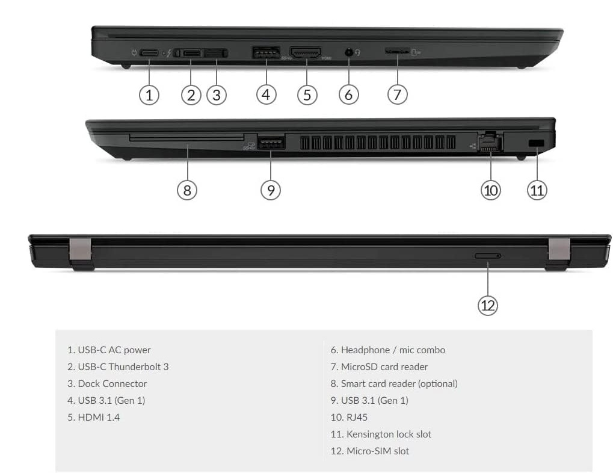

# USB Port Mapping

## Ports and Slots

### XHCI Controller

Location | Connector (Type) | Device 
:-------:|----------|---------
Left | USB-C w/Switch (9)| **HS05**   **SS01**
Left | Type A (3)| **HS04**   **SS01**
Right | Type A (3)| **HS03**   **SS03**
Internal | Internal (255) | **HS08** (IR Webcam)   **HS09** ("Vendor Device")   **HS10** (BT)

&rarr; Declared in `SSDT-XHUB.aml`

	
